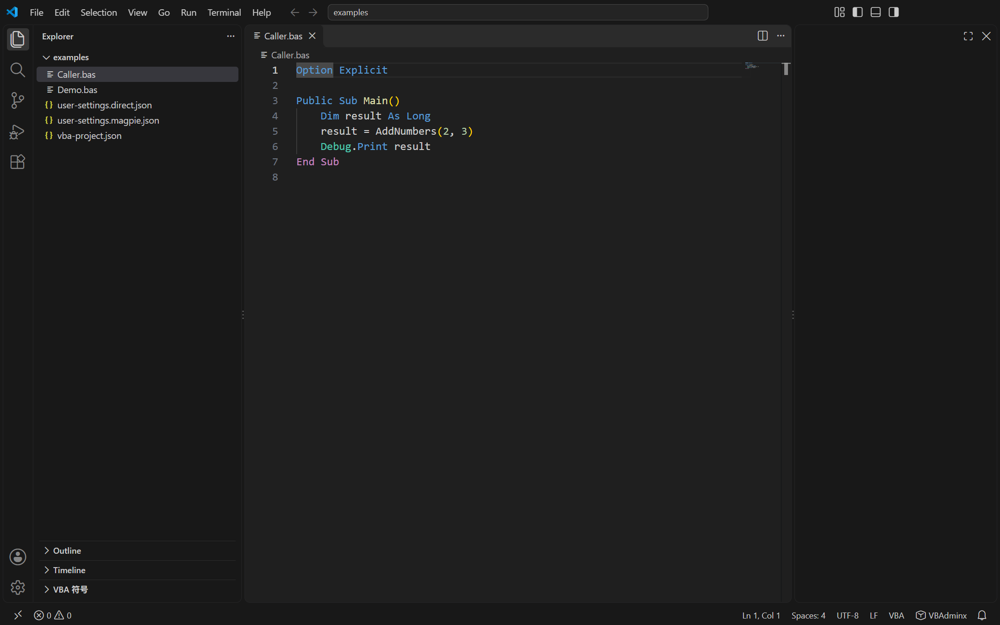
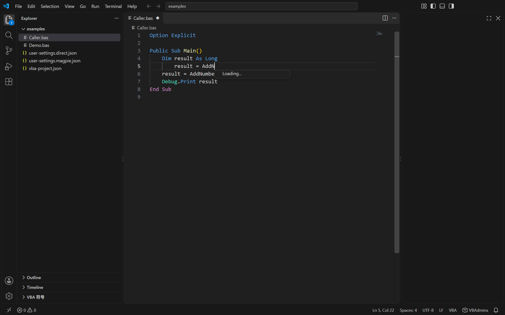
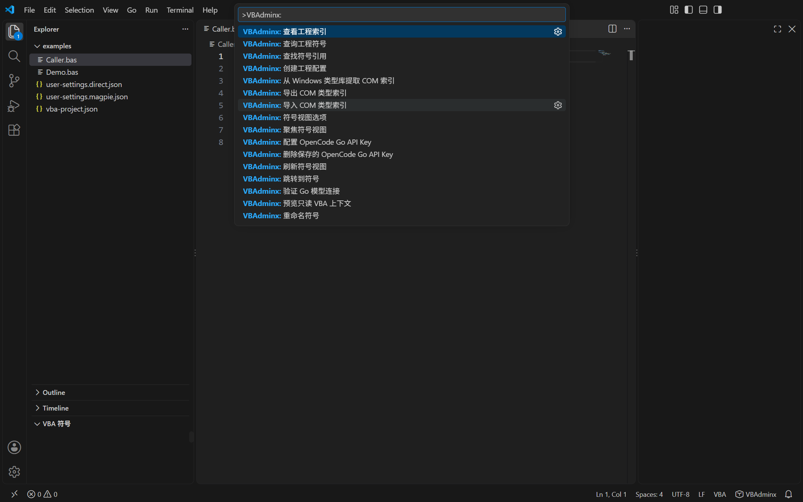
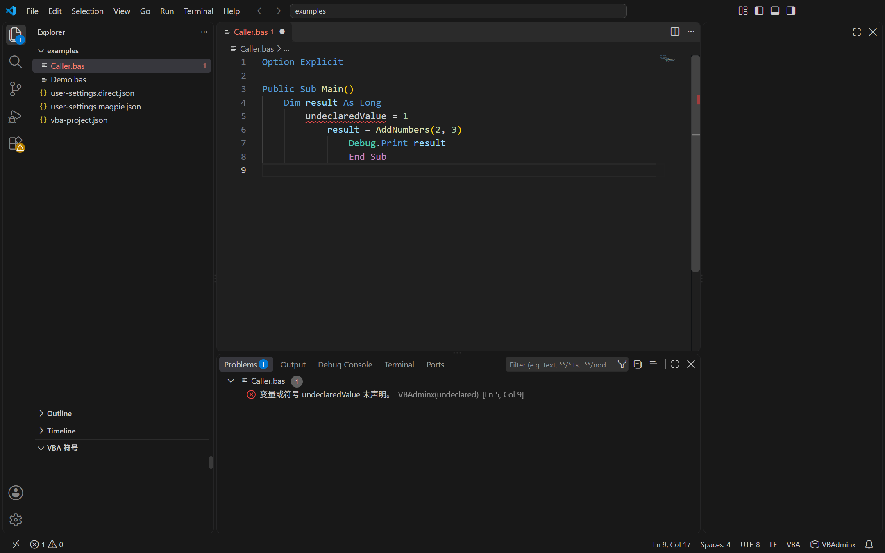
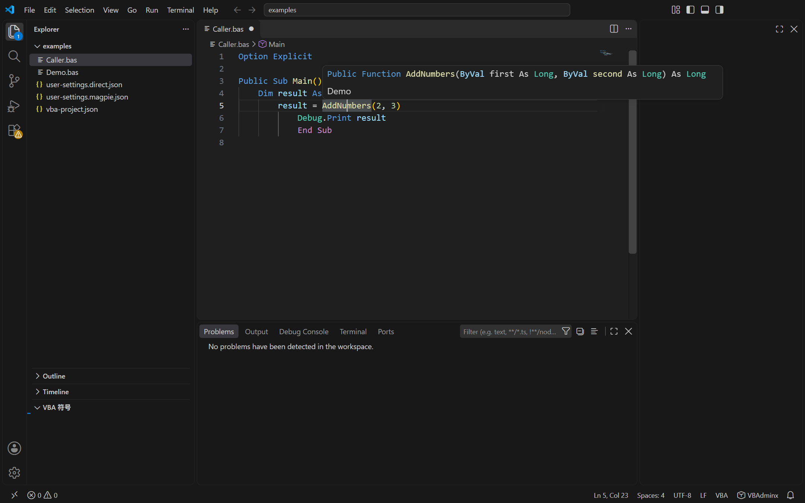
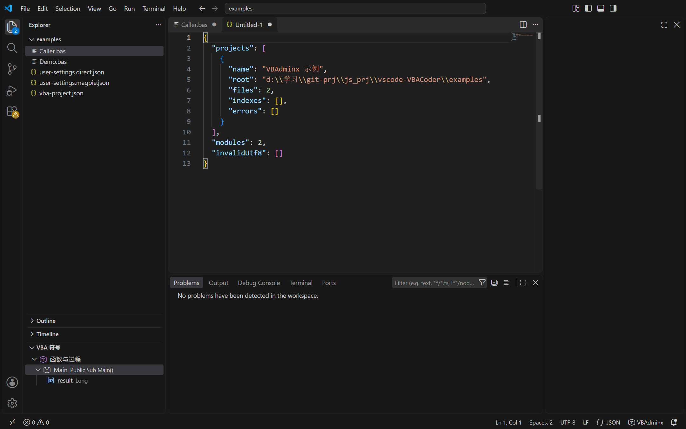
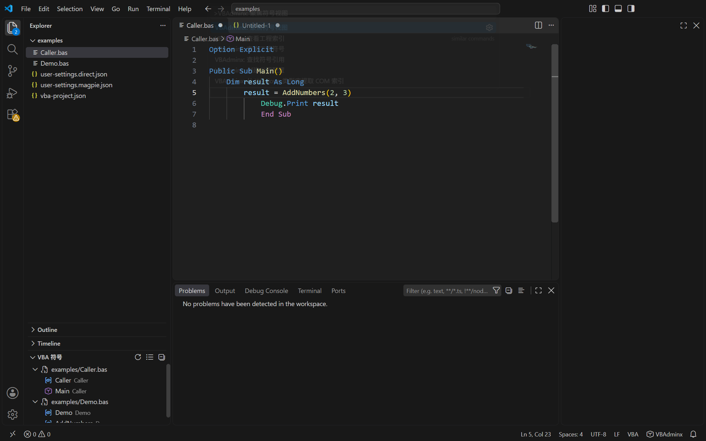
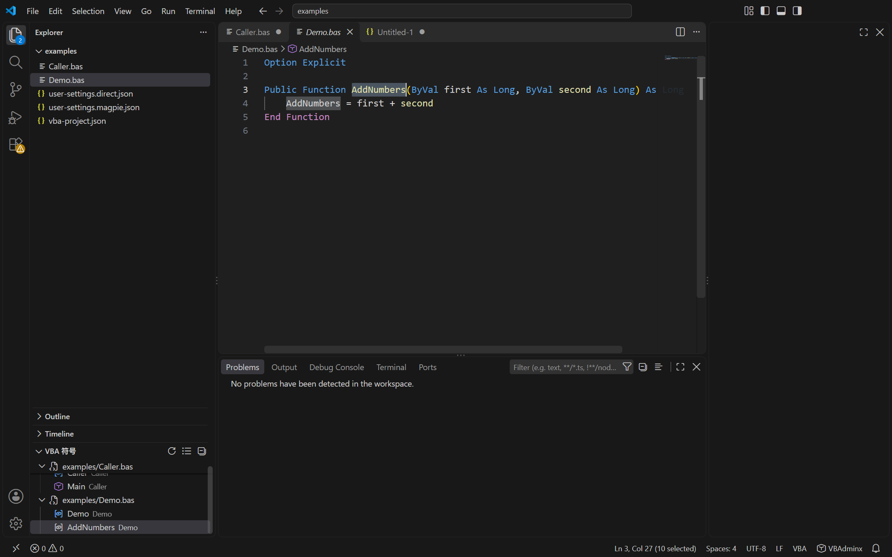
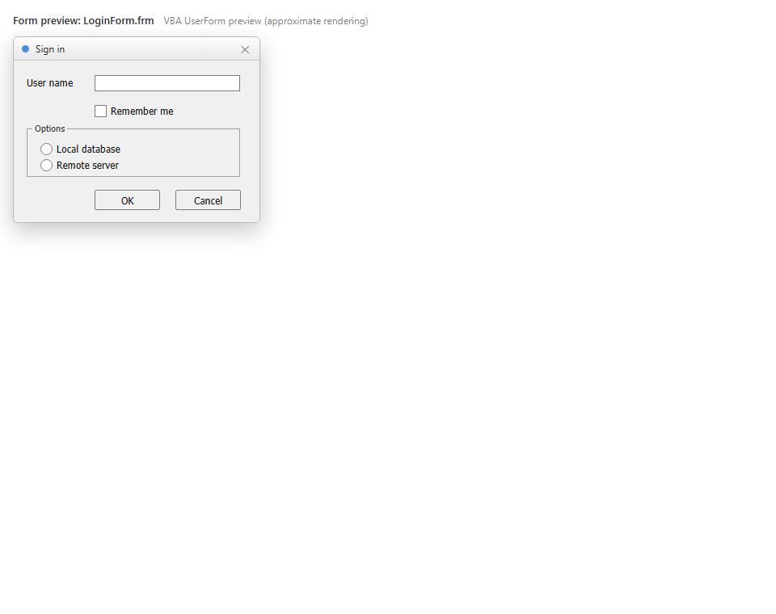

# VBAdminx 功能总结

版本：0.2.0　更新日期：2026-10-31

VBAdminx 是面向**导出的 VBA 工程**（`.bas` / `.cls` / `.frm`）的 VS Code 扩展，由三块能力组成：

1. **离线语言服务器（LSP）**：解析、诊断、补全、导航、重命名、格式化、折叠、语义高亮。
2. **COM 可移植类型索引**：Windows 提取 + 全平台导入/导出/校验 + 工程显式版本引用。
3. **只读 AI 上下文工具与可选 Go 模型适配器**：AI 不替代基础语言服务，无 AI 时语言服务照常可用。

边界（需求 BND）：不连接 Office、不运行宏、不调试宏、不提供窗体设计；源码工程的导入导出由其他工具负责。

本文档只记录**已实现并经本机实测**的功能；验收目标与需求以 [requirements.md](requirements.md) 为准，实现细节见 [implementation.md](implementation.md)。

---

## 1. 实测验证概览

| 项目 | 结果 | 证据 |
|---|---|---|
| 单元测试 | 134 / 134 通过 | `output/unit-test-check.json` |
| VS Code API 检查（宿主 1.144.0） | 31 项通过，`failed: []` | `output/vscode-api-check.json` |
| 语法/语义用例（依据 MS-VBAL 的 106 项用例） | 自动判定 97 / 105 通过，**误报 0** | `output/vba-cases-report.json` |
| 真实工程样例（61 文件，只读） | 唯一 Error 为真实缺 `End Sub`，无新增误报 | `output/sample-check.json` |
| COM 类型提取实测 | `stdole2.tlb`：13 类型 / 90 成员，成员补全可用 | `output/com-check.json` |
| 性能（1000 文件 / 10 万行） | 冷启动 936.68 ms；增量诊断通知 164.51 ms；补全 P95 8.77 ms | `output/lsp-benchmark.json` |
| 性能（进程内口径，同负载） | 索引 318.74 ms；增量诊断 32.45 ms；补全 P95 1.82 ms | `output/benchmark.json` |
| 安装包与交付核对 | `output/vbadminx-vscode-0.1.0.vsix`，包内文件与构建一致、隔离安装运行时一致 | `output/验收报告.md` |

性能口径说明：LSP 数字含子进程启动、磁盘扫描与 JSON-RPC；进程内数字仅为解析与语言服务 CPU。测试机为 16 核 / 28 GB，强于需求 PERF-01 规定的 4 核 / 16 GB 参考硬件，**不能据此判定参考硬件达标**。

---

## 2. 语言服务功能

| 能力 | 触发方式 | 行为要点 |
|---|---|---|
| **符号补全** | 输入前缀 + `Ctrl+Space` | 当前作用域可见符号：局部变量（含参数）→ 本模块 → 同工程其他模块 Public 成员 → 类型索引外部符号 → VBA 内建函数/常量 → 关键字；按此优先级排序。大小写不敏感 |
| **成员补全** | `对象.` | 工程内模块/类成员 + COM 类型索引成员 + `Debug`/`Err`/`Collection` 内建成员。类型未知时**不给确定成员列表**（LIM-01） |
| **With 隐式成员** | `With obj` 内 `.成员` | 绑定最近一层 `With` 属主，按其类型给成员 |
| **链式类型** | `obj.Child.`、`obj.GetChild().` | 逐级使用返回类型；`Excel.Application.` 这类库限定名不与同名类型混淆 |
| **悬停** | 鼠标悬停 | 显示完整签名与注释文档；跨文件符号标注声明所在模块，外部符号标注来源库（COM-07） |
| **签名提示** | 输入 `(` 或 `,` | 显示已知过程的参数序列并高亮当前参数位；命名实参（`count:=2`）绑定到被调过程参数 |
| **定义跳转** | `F12` | 同工程跳到声明；外部符号跳到只读类型声明虚拟文档 |
| **引用查询** | `Shift+F12` | 返回工程内确定引用；遍历逐模块响应取消（TST-02） |
| **文档符号 / 工作区符号** | 大纲 / `Ctrl+T` | 工作区查询跨工程聚合，但**不共享符号解析作用域**（PRJ-02） |
| **重命名** | `F2` | 确定引用默认参与；推断候选（`Application.Run` / `OnAction` 字符串）以列表展示且**默认不勾选**；差异预览后应用；单次撤销可还原跨文件修改；保留类型后缀、属性访问器成组修改、拒绝被局部同名遮蔽的新名 |
| **格式化** | `Shift+Alt+F`（文档/选区） | 默认 4 空格缩进 + 关键字标准大小写；保留 BOM、逐行 CRLF/LF、注释与字符串内容、条件编译语义；设计段默认原样。可选：安全折行、连续 `Dim` 排序、设计段排版（默认关） |
| **折叠** | 编辑器折叠 | 过程、各类块、注释连续段、窗体设计段 |
| **语义高亮** | 自动 | 仅为**可解析**的符号着色，未解析引用不赋确定语义色（LSP-02） |
| **诊断** | 自动（100 ms 防抖） | 见下表 |
| **快速修复** | 灯泡 / `Ctrl+.` | `name-case` 统一为声明名；`undeclared` 在过程声明行后插入 `Dim <name> As Variant`。**两者均先差异预览**（QF-01/02） |
| **符号面板（左侧）** | 侧边栏“VBA 符号” | 树形列出函数、过程、属性、变量、常量、类型；点击项跳转并选中该符号；光标移动时左侧同步显示并选中当前所在符号；标题栏按钮提供刷新与视图选项；树项右键可查找引用/重命名。详见 §2.1 |

### 2.1 符号面板（左侧“VBA 符号”视图）

| 能力 | 说明 |
|---|---|
| 列表内容 | 函数 / 子过程 / 属性 / 变量 / 常量 / 类型；工程模式下按模块分组，并展开过程内的参数与局部变量 |
| 点击跳转 | 点击树项 → 打开对应文件并把编辑器选区设为该符号名称（实测点击 `AddNumbers` 后选中 10 个字符） |
| 同步显示 | 移动光标或切换编辑器时，树中自动定位并选中当前所在符号（取包含光标且范围最小的符号） |
| 标题栏按钮 | ① 刷新；② 视图选项（分步菜单）：显示范围（当前文件 / 整个工程）、排序（按出现位置 / 按名称）、显示内容（全部 / 仅函数与过程 / 仅变量与常量）。选项存于工作区状态，重启后保留；③ 设置（齿轮）直接打开本扩展的设置页 |
| 自动展开 | 打开 VBA 工程（存在 `vba-project.json`）或打开 VBA 文件后，左侧“VBA 符号”视图自动展开一次；每个扩展会话只展开一次，用户收起后不会被反复强制打开 |
| 右键菜单 | 查找引用（`Shift+F12`）、重命名（`F2`），作用于当前编辑器光标处符号 |
| 数据来源 | 当前文件：文档符号；整个工程：语言服务器 `vba/context` 的 `symbols` 模式，遵循工程隔离（PRJ-02），上限 800 项 |
| 刷新时机 | 切换/编辑/保存文档（防抖 400 ms）自动刷新，或点标题栏刷新按钮 |

### 诊断类别

| 类别 | 码（节选） | 说明 |
|---|---|---|
| 词法 | `lex.unterminatedString`、`lex.lineTooLong`、`lex.invalidCharacter`、`lex.continuationComment`、`lex.tooManyContinuations` | 字符串未闭合、物理行 >1023 字符、非法字符、续行符后注释、行连接 >24 |
| 结构 | `syntax.missingEnd`、`syntax.unexpectedEnd`、`syntax.mismatchedEnd`、`syntax.missingThen`、`syntax.missingName`、`syntax.optionPosition`、`syntax.optionDuplicate`、`syntax.deftypePosition`、`syntax.exitWhile` | 块配对、声明缺名、Option/Deftype 位置、Exit While |
| 条件编译 | `cond.unknown`（Information，可配）、`cond.missingExpression` 等 | 未知常量分支整段排除并提示（LIM-02） |
| 语义 | `undeclared`、`name-case`、`type-mismatch`、`argument-count` | `undeclared` 仅在 `Option Explicit` 模块且工程无缺失外部类型时报（LIM-03）；其余只在证据确定时报 |
| 声明语义 | `ambiguous-name`、`param-optional-order`、`param-array-position`、`param-array-unique`、`param-array-byref`、`type-public-in-class`、`withevents-non-object`、`friend-in-standard` | 过程重名、参数规则、类模块 Type 可见性、WithEvents 类型、Friend 位置 |
| 工程 | `project-conflict` | 配置与导出头冲突、模块重名（冲突时禁用重命名） |
| 外部类型 | `missing-type`、`missing-host`、`missing-external-symbol`（Information，可配） | 缺类型/宿主/外部符号信息时只提示，源码级能力仍可用 |
| 编码 | `encoding` | 非 UTF-8：暂停语义分析并提示（INP-03） |

---

## 3. 工程与配置

- **工程发现**：任一层存在 `vba-project.json` 即为工程；无配置时，仅在工作区根或直接子目录同时出现 `模块/` `类模块/` `表格对象/` `窗体/` 四类目录时按约定识别（PRJ-03/04）。
- **多工程隔离**：符号隔离；嵌套工程时父扫描跳过子工程根；不归属工程的文件按单文件模式（PRJ-02/05）。
- **配置字段**：`name` `host` `targetBits`（决定 `Win32`/`Win64` 分支）、`constants`（条件编译常量）、`modules`（模块名/类型映射）、`typeIndexes`、`references`（必填 `name/guid/major/minor/lcid/bitness`）。JSON 校验绑定 `schemas/vba-project.schema.json`。
- **模块名优先级**：显式配置 > 标准 VBE 头（`Attribute VB_Name`）> 目录约定 > 扩展名/文件名（CFG-02/03）。
- **导出头与保护**：识别 `Attribute`、`VERSION`/`BEGIN…END` 设计段并保护；`.frx` 不解析、不改写（SYN-04/05）。
- **URI 归一**：`canonicalUri()` 处理 Windows 盘符与转义差异，避免同一文件被索引两次。

---

## 4. COM 类型索引

| 能力 | 平台 | 说明 |
|---|---|---|
| 提取 | 仅 Windows 扩展主机 | 运行 `scripts/export-com.ps1`，用 `LoadTypeLibEx(REGKIND_NONE)` 读公开类型元数据；不注册、不加载执行、不启动 Office；位数（32/64）显式选择并回验 |
| 自动查找 | 仅 Windows 扩展主机 | 按设置 `vbadminx.com.softwareList` 的关键词只读扫描 `HKCR\TypeLib`，列出匹配的类型库（名称 / 版本 / 平台 / 路径），多选后批量调用提取脚本写入 `.vba/type-indexes/`；确认后可直接加入 `vba-project.json` 的 `typeIndexes`。不注册、不执行组件 |
| 导入 / 导出 | 全平台 | 无 BOM UTF-8；严格校验（格式版本、GUID、版本、LCID、位数、体积上限） |
| 显式版本 | 全平台 | `references` 与索引逐项比对；重复/多版本索引报错；与 `targetBits` 不匹配报错（COM-03） |
| 外部定义导航 | 全平台 | `vba-library:` 只读虚拟文档展示类型、成员、参数与所属库版本 |
| 成员补全 | 全平台 | 加载索引后 `StdFont` 等类型给出 `Name`/`Size` 等成员（实测 13 类型 / 90 成员，含 coclass 默认接口成员与事件） |

索引导入后需**手工**把路径加入 `typeIndexes`，扩展不静默改写工程配置。

---

## 5. 编码处理

- 仅支持 UTF-8（允许带/不带 BOM），保存保留原 BOM 状态与换行形式，不静默转码（INP-02）。
- 非 UTF-8：暂停语义分析并提示在扩展外转换；打开时按磁盘字节保留 BOM 状态（INP-03）。
- 不承诺拦截用户手动“另存为”导致的转码。

---

## 6. AI 能力

- **只读工具 `get_vba_context`**：四种模式 —— `selection`（选区，12000 字符截断）、`diagnostics`（最多 100 条）、`symbols`（工程符号，可带 `query`）、`references`（光标处确定引用，超 24000 字符截断）。调用前有确认框，工具只读、不改写源码。
- **可选 Go 模型适配器**：注册 vendor `vbadminx-go`。默认 `magpie` 模式复用本机代理（模型 `opencode-go/deepseek-v4.1-flash`）；`direct` 模式使用官方 Go API，密钥仅存 SecretStorage 或扩展主机环境变量。
- **协议细节**：工具结果先于同一消息中的新用户文本；保持会话头；DeepSeek 强制工具调用时关闭 Thinking；请求可取消。
- 无 AI 时基础语言服务不受影响（AI-05）。

---

## 7. 命令与设置

贡献命令（命令面板输入 `VBAdminx:`）：

| 命令 | 作用 |
|---|---|
| `vbadminx.projectStatus` | 查看工程索引（服务器返回工程/模块/类型索引状态） |
| `vbadminx.createProject` | 生成 `vba-project.json`（已存在不覆盖） |
| `vbadminx.importTypeIndex` / `exportTypeIndex` | 导入 / 导出 COM 类型索引 |
| `vbadminx.extractComTypeIndex` | 从 Windows 类型库提取索引 |
| `vbadminx.discoverCom` | 按设置中的软件列表查找 COM 类型库并批量提取 |
| `vbadminx.openSettings` | 打开本扩展的设置页（符号视图标题栏齿轮按钮） |
| `vbadminx.editSnippets` | 创建/打开自定义 VBA 代码片段文件 |
| `vbadminx.previewForm` | 预览 `.frm` 窗体（编辑器右上角按钮） |
| `vbadminx.configureGo` / `clearGoKey` | 配置 / 删除 Go API Key |
| `vbadminx.testGo` | 验证 Go 模型连接（只发合成问题） |
| `vbadminx.previewContext` | 预览只读 VBA 上下文 |
| `vbadminx.focusSymbols` | 聚焦（并滚动到）“VBA 符号”视图 |
| `vbadminx.refreshSymbols` | 刷新符号视图（同时作为视图标题栏按钮） |
| `vbadminx.symbolsOptions` | 符号视图选项菜单：范围 / 排序 / 过滤（标题栏按钮） |
| `vbadminx.symbolsGoto` | 跳转到符号并选中（点击树项触发） |
| `vbadminx.symbolsFindReferences` / `symbolsRename` | 符号面板右键菜单：查找引用 / 重命名 |
| `vbadminx.workspaceSymbols` | 查询工程符号（供面板使用，转发语言服务器） |

设置：`vbadminx.language`（auto/en/zh-cn/zh-tw/ja/ko）、`vbadminx.snippets.customPath`（自定义片段文件）、`vbadminx.com.softwareList`（自动查找 COM 的软件/库名称）、`vbadminx.format.*`（keywordCase / lineWrap / reorderDeclarations / formatDesign，后三项默认关）、`vbadminx.diagnostics.missingInformation`（information/hint/off）、`vbadminx.diagnostics.nameCase`、`vbadminx.go.*`（application 作用域，须写入用户设置）。

---

## 8. 界面与编辑增强（0.2.0）

### 8.1 多语言

- 支持 **英文 / 简体中文 / 繁体中文 / 日语 / 韩语**。设置 `vbadminx.language` 可选 `auto` 或具体语言；`auto` 跟随 VS Code 显示语言，未匹配时显示英文（例如 `fr` → 英文）。
- 生效范围：扩展界面文案（命令提示、符号视图、COM 流程、代码片段、窗体预览）以及清单本地化（命令面板标题、视图名、设置说明，随 VS Code 语言切换）。
- 切换语言后提示与符号分组即时刷新；已打开的窗体预览自动重建。
- 语言服务器的**诊断文本与内置符号说明**暂保持简体中文，后续可扩展。

### 8.2 内置与自定义代码片段

- 内置 `snippets/vba.json`，覆盖 `Sub` / `Function` / `Property Get/Let/Set`、`If` / `If…Else` / `If…ElseIf`、`Select Case`、`For` / `For Each` / `Do`、`With`、`On Error GoTo`、`Dim` / `Const`、`Enum` / `Type`、`MsgBox`、`Debug.Print`、`Array`、`Collection.Add`、`Open` 等。
- 设置 `vbadminx.snippets.customPath` 指向自定义片段 JSON（VS Code 片段语法，允许 `//` 与 `/* */` 注释）；命令 `VBAdminx: 编辑 VBA 代码片段` 会在缺失时创建模板并打开。
- 自定义片段以补全项呈现，按输入前缀不区分大小写匹配；保存文件后立即生效。

### 8.3 窗体预览（.frm）

- 打开 `.frm` 后，编辑器右上角出现 **预览** 按钮（`vbadminx.previewForm`），在侧边 WebView 中按 VBA 设计器样式还原窗体。
- 解析 `Begin … End` 设计段（含 `BeginProperty Font`），把 twip 按 96 DPI 换算为像素（1 px = 15 twips），还原位置、尺寸、标题、前景/背景色、字体与常用控件：CommandButton、Label、TextBox、ComboBox、ListBox、CheckBox、OptionButton、Frame、Image、ScrollBar、SpinButton、TabStrip、MultiPage 等。
- 未识别的控件 GUID 以虚框占位显示，不阻断预览。
- 编辑文件时 250 ms 防抖热更新；只读，不执行 VBA；`.frx` 二进制资源不解析，图片以占位呈现。

---

## 9. 截图展示

以下截图由 `npm run capture` 生成，使用**已安装的 VSIX 扩展**运行（installed-vsix 模式），非开发模式：

| 截图 | 展示内容 |
|---|---|
|  | ① VBA 语法高亮、状态栏 `VBAdminx` 入口、语言模式与编码/换行显示 |
|  | ② 跨文件符号补全：`AddNumbers` 带完整签名出现，来自另一模块 `Demo.bas` |
|  | ③ 命令面板中的 `VBAdminx:` 贡献命令（截图生成于 0.1.0；0.2.0 新增 COM 查找、设置、片段编辑与窗体预览命令） |
|  | ④ 问题面板显示 `undeclaredValue` 未声明诊断（增量发布） |
|  | ⑤ 悬停显示 `AddNumbers` 的签名与类型信息 |
|  | ⑥ “查看工程索引”命令输出的工程/模块/类型索引状态 JSON |
|  | ⑦ 左侧“VBA 符号”面板：工程模式按模块分组列出函数与变量（`Main`、`result`、`AddNumbers`），标题栏含刷新与视图选项按钮 |
|  | ⑧ 点击面板中的 `AddNumbers` → 右侧打开 `Demo.bas` 并选中该名称（状态栏 `10 selected`），左侧同步高亮 |
|  | ⑨ 0.2.0 窗体预览：按 `examples/LoginForm.frm` 设计段还原 UserForm（位置、尺寸、颜色、字体与控件）。由 `npm run preview:form` 用 Playwright/Chromium 渲染截图，非 VS Code 集成截图 |

截图保存在 `output/screenshots/`，**不随扩展包分发**（`.vscodeignore` 排除 `output/`），需要时用 `npm run capture` 重新生成。

---

## 10. 边界与当前不做

- 解析器是**容错的结构级分析器，不是 VBA 编译器**；诊断不等同编译结论，不做全表达式类型推导。
- **不做表达式语法校验**：`a, b = 1`、`Foo (1, 2)`、`a = (1, 2)` 等非法表达式不报错（用例 STMT-03b/04b、EXPR-03b/11、DIAG-02 记为漏报）。
- Default 属性唯一性（SEM-07b）与 Const 常量表达式合法性（SEM-09b）未校验。
- COM 索引不表达 record/alias 类型；`CreateObject` 等动态对象成员在无类型索引时不确定。
- 不支持 VB6 工程与 VB.NET（SYN-03）；`.frx` 资源不解析（SYN-04/05）。窗体预览是**近似渲染**（控件样式与系统主题存在差异，图片与列表项等 `.frx` 内容以占位呈现），不提供设计编辑。
- 语言服务器诊断与内置符号说明暂为简体中文；多语言覆盖扩展界面与清单。
- **尚未验收**（需用户操作或特定环境）：真实 AI 聊天 UI 端到端、官方 Go 直连、macOS/Linux/Remote SSH/WSL/容器、参考硬件（4 核 / 16 GB）性能复测。
